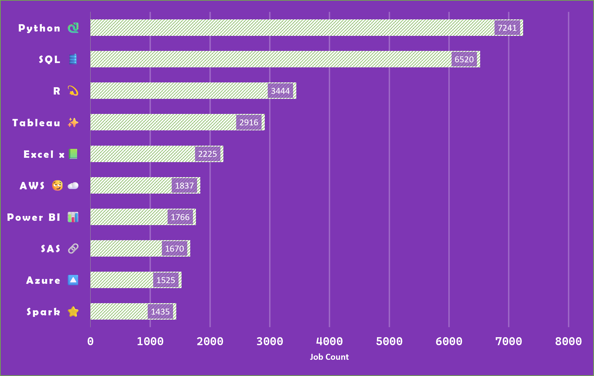
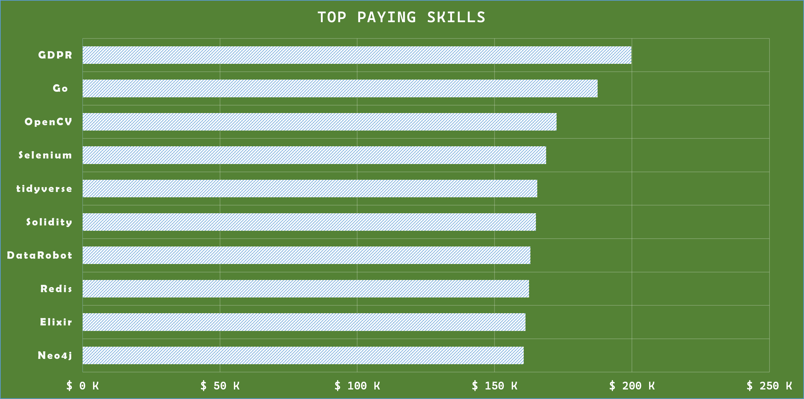
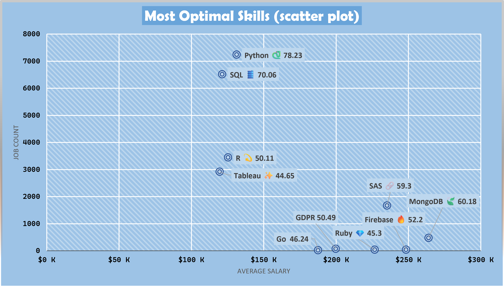
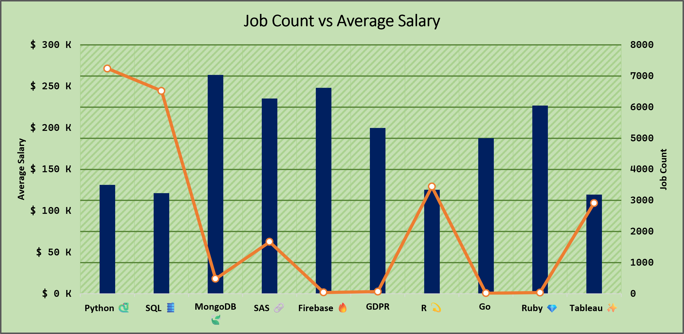

 This document is not complete yet!!

# Questions to Answer ⁉️ 🟰
- ### What are the Top paying Jobs for my role
<details>
<summary>Top Paying Jobs</summary>

```sql
/* What are the top paying jobs for my roles, location and country */

SELECT
    job_title,
    job_title_short,
    company_dim.name AS company_name,
    job_location,
    job_country,
    ROUND (salary_year_avg, 2) AS average_salary

FROM
    data_jobs_postings

LEFT JOIN 
    company_dim
    ON data_jobs_postings.company_id = company_dim.company_id

WHERE
    job_title_short IN ('Data Analyst', 'Data Scientist', 'Business Analyst')
    AND
    (   LOWER (job_location) LIKE '%india%' -- in India
     OR LOWER (job_location) LIKE '%anywhere%' ) -- Remote Jobs
    AND
    salary_year_avg IS NOT NULL

ORDER BY
    salary_year_avg DESC

LIMIT  500;

```
</details>

- ### What are skills required for these top-paying roles for these jobs
<details>
<summary>Skills Required for those Jobs</summary>

```sql
SELECT
    skills_dim.skills AS job_skill,
    ROUND (AVG (data_jobs_postings.salary_year_avg), 0) AS average_salary
FROM
   data_jobs_postings   
INNER JOIN
    skills_to_job ON data_jobs_postings.job_id = skills_to_job.job_id
INNER JOIN
    skills_dim ON skills_to_job.skill_id = skills_dim.skill_id

WHERE
    data_jobs_postings.job_title_short IN ('Data Analyst', 'Data Scientist', 'Business Analyst')
    AND
    (   LOWER (job_location) LIKE '%india%'   -- in India
     OR LOWER (job_location) LIKE '%anywhere%' ) -- Remote Jobs
    AND
    salary_year_avg IS NOT NULL
GROUP BY
  skills_dim.skills
ORDER BY
    average_salary DESC;

```
</details>

- ### What are most in demand skills for my role

<details>
<summary>Most In Demand Jobs For My Role</summary>

```sql
SELECT
    skills_dim.skills AS job_skill,
    COUNT(data_jobs_postings.job_id) AS job_count
FROM
   data_jobs_postings   
INNER JOIN
    skills_to_job ON data_jobs_postings.job_id = skills_to_job.job_id
INNER JOIN
    skills_dim ON skills_to_job.skill_id = skills_dim.skill_id

WHERE
    data_jobs_postings.job_title IN ('Data Analyst', 'Data Scientist', 'Business Analyst')
    AND
    (   LOWER (job_location) LIKE '%india%' 
     OR LOWER (job_location) LIKE '%anywhere%' )

GROUP BY
  skills_dim.skills
ORDER BY
    job_count DESC;
```
</details>

<details>
<summary>Insights</summary>



</details>

- ### What are the top skills based on the salary for my role
<details>
<summary>Top Skills Based on Salary</summary>

```sql
SELECT
    skills_dim.skills AS job_skill,
    ROUND (AVG (data_jobs_postings.salary_year_avg), 0) AS average_salary
FROM
   data_jobs_postings   
INNER JOIN
    skills_to_job ON data_jobs_postings.job_id = skills_to_job.job_id
INNER JOIN
    skills_dim ON skills_to_job.skill_id = skills_dim.skill_id

WHERE
    data_jobs_postings.job_title_short IN ('Data Analyst', 'Data Scientist', 'Business Analyst')
    AND
    (   LOWER (job_location) LIKE '%india%'   -- in India
     OR LOWER (job_location) LIKE '%anywhere%' ) -- Remote Jobs
    AND
    salary_year_avg IS NOT NULL
GROUP BY
  skills_dim.skills
ORDER BY
    average_salary DESC;
```
</details>

<details>
<summary>Insights</summary>



</details>

- ### What are the most optimal skills to learn

<details>
<summary>Most Optimal Skills</summary>

```sql
WITH in_demand_skills AS (
    SELECT
    skills_dim.skill_id,
    COUNT(data_jobs_postings.job_id) AS job_count
FROM
   data_jobs_postings   
INNER JOIN
    skills_to_job ON data_jobs_postings.job_id = skills_to_job.job_id
INNER JOIN
    skills_dim ON skills_to_job.skill_id = skills_dim.skill_id

WHERE
    data_jobs_postings.job_title IN ('Data Analyst', 'Data Scientist', 'Business Analyst')
    AND
    (   LOWER (job_location) LIKE '%india%' 
     OR LOWER (job_location) LIKE '%anywhere%' )

GROUP BY
  skills_dim.skill_id
),

top_paying_skills AS (
    SELECT
    skills_dim.skill_id,
    skills_dim.skills AS job_skill,
    AVG (data_jobs_postings.salary_year_avg) AS average_salary
FROM
   data_jobs_postings   
INNER JOIN
    skills_to_job ON data_jobs_postings.job_id = skills_to_job.job_id
INNER JOIN
    skills_dim ON skills_to_job.skill_id = skills_dim.skill_id

WHERE
    data_jobs_postings.job_title_short IN ('Data Analyst', 'Data Scientist', 'Business Analyst')
    AND
    (   LOWER (job_location) LIKE '%india%'   -- in India
     OR LOWER (job_location) LIKE '%anywhere%' ) -- Remote Jobs
    AND
    salary_year_avg IS NOT NULL
GROUP BY
  skills_dim.skill_id
),
normalized_metrices AS (
    SELECT
    top_paying_skills.job_skill,
    in_demand_skills.job_count,
    top_paying_skills.average_salary,
    (job_count - MIN(job_count) OVER())::NUMERIC /
    (MAX(job_count) OVER() - MIN(job_count) OVER())
    AS normalized_count,
    (average_salary - MIN(average_salary) OVER())::NUMERIC /
    (MAX(average_salary) OVER() - MIN(average_salary) OVER())
    AS normalized_salary

    FROM  top_paying_skills
    INNER JOIN
        in_demand_skills ON top_paying_skills.skill_id = in_demand_skills.skill_id 
)
SELECT 
    normalized_metrices.job_skill,
    normalized_metrices.job_count,
    ROUND (normalized_metrices.average_salary, 2) AS average_salary,
    ROUND ((normalized_metrices.normalized_salary * 0.5 +
            normalized_metrices.normalized_count * 0.5)*100, 2)
    AS skill_score

FROM 
    normalized_metrices
ORDER BY
    skill_score DESC;
```
</details>

<details>
<summary>Insights</summary>




</details>

